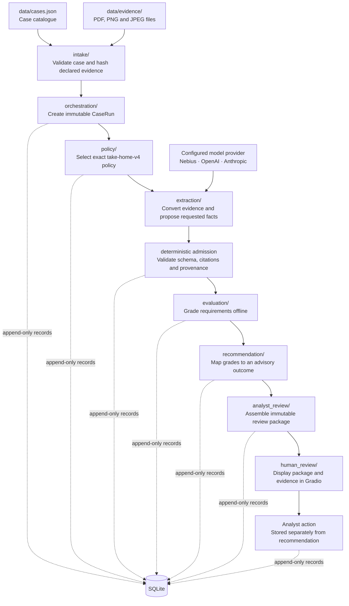

# Dispute Copilot

Dispute Copilot turns a payment-dispute case and its submitted evidence into a
traceable, policy-grounded recommendation for an analyst. It combines
model-assisted evidence extraction with deterministic policy evaluation,
immutable lineage, and a local Gradio review interface.

`take-home-v4` is the default rulebook. Recommendations are advisory: the
application does not submit a chargeback response or take any external dispute
action.

## What the system does

For each case, Dispute Copilot:

1. validates the case and every declared evidence file;
2. selects the exact v4 policy from the case's scheme and reason code;
3. extracts only the evidence facts requested by that policy;
4. validates fact types, citations, document identity, and provenance;
5. evaluates policy requirements with deterministic three-valued logic;
6. maps the result to an advisory recommendation;
7. creates a persisted analyst-review package; and
8. displays the result, supporting evidence, gaps, and lineage in Gradio.

The analyst sees the recommendation, requirement grades, admitted facts,
document/page citations, unresolved evidence gaps, a suggested next action,
source evidence, and technical lineage. Human review remains separate from the
system recommendation.

## System at a glance

The diagram maps each workflow stage to the package that owns it:



### Behavioural boundaries

- The case supplies its scheme and reason code; callers cannot substitute a
  different policy.
- Evidence filenames come from the immutable case snapshot. Extra files in the
  directory are not silently discovered.
- Evidence hashes are checked again before extraction, so the model processes
  the exact files admitted at intake.
- The model proposes evidence facts only. It does not grade requirements or
  choose a recommendation.
- Text assertions and visible-pixel observations remain separate. Exact
  document and page provenance is required.
- Invalid extraction fails closed. Partial results are not admitted.
- `NOT_FOUND` means a fact was not established; it never proves the opposite.
- Evaluation, recommendation mapping, and review-package assembly are
  deterministic and run without a model call.

## Walkthrough: CB-2025-0006

`CB-2025-0006` is a Visa 13.3 case with three declared files:

- a product listing;
- a front-view delivery photograph; and
- a returns policy.

The workflow is:

1. **Intake** validates the case, verifies all three files, and freezes their
   paths, sizes, media types, and SHA-256 hashes in a new `CaseRun`.
2. **Policy selection** reads `visa / 13.3` from that frozen run and selects the
   exact `take-home-v4` policy snapshot.
3. **Extraction** may admit that the listing describes the product, the image
   caption reports a delivery, and the visible pixels appear to show a
   sage-green armchair.
4. **Validation** requires each admitted fact to cite the supplied canonical
   document text or carry a clearly labelled visual-model observation.
5. **Evaluation** must not turn a front-view image into proof that the chair
   has no hidden defect, does not wobble, fully matches the listing, or that a
   return route was completed or refused.
6. **Recommendation** is derived from the deterministic requirement grades.
   The v4 fixture-backed acceptance contract grades R1 `SATISFIED`, R2
   `NOT_ESTABLISHED`, and R3 `NOT_ESTABLISHED`, producing
   `INSUFFICIENT_EVIDENCE_TO_REPRESENT`.
7. **Analyst review** presents that advisory result alongside the exact facts,
   citations, gaps, evidence, and immutable lineage.

Live model wording can vary, but it must pass the same deterministic admission
and decision boundaries.

## Moving from one case to another

Every attempt creates an independent lineage:

```text
Case
└── CaseRun
    └── PolicySelection
        └── FactResolutionResult
            └── RequirementEvaluationResult
                └── RecommendationResult
                    └── AnalystReviewPackage
```

Running another case creates a different chain. It does not reuse the previous
case snapshot, evidence, facts, policy snapshot, or recommendation.

In the UI:

- **Run Selected Case** starts one new attempt for the selected case.
- **Run All Cases** processes all ten supplied cases sequentially.
- One failed case is recorded as `FAILED`; the remaining cases continue.
- Selecting a completed case loads its persisted package without another model
  call.
- Selecting a failed or unprocessed case clears the previous case's result and
  shows its true status.
- Retrying a case creates a new attempt and preserves the earlier lineage.

The queue states are `NOT_RUN`, `QUEUED`, `RUNNING`, `COMPLETED`, and `FAILED`.

## Repository map

```text
dispute-copilot/
├── src/dispute_copilot/
│   ├── application/       # Stable single-case, batch and cached-view service
│   ├── domain/            # Immutable business contracts
│   ├── intake/            # Case loading, evidence registration and hashing
│   ├── orchestration/     # CaseRun creation
│   ├── policy/            # Rulebook import and exact policy selection
│   ├── extraction/        # Conversion, provider adapters and fact admission
│   ├── evaluation/        # Deterministic three-valued requirement grading
│   ├── recommendation/    # Versioned advisory outcome mapping
│   ├── analyst_review/    # Persisted analyst-review package assembly
│   ├── human_review/      # Gradio presentation and analyst decisions
│   └── repositories/      # SQLite persistence boundaries
├── data/
│   ├── cases.json         # Supplied case catalogue
│   ├── evidence/          # Submitted case evidence
│   ├── rulebooks/         # Versioned source, transcript, facts and policies
│   └── baselines/         # Protected reproducibility checkpoints
├── docs/                  # Detailed operating and validation documentation
└── tests/                 # Unit, integration and end-to-end tests
```

## Quick start

### 1. Create the environment

Python 3.11 or newer is required.

```bash
git clone <repository-url>
cd dispute-copilot

python3 -m venv .venv
source .venv/bin/activate
python -m pip install -e ".[dev]"
```

Verify the installation:

```bash
dispute-copilot --version
python -m pytest -q
```

### 2. Configure a live provider

Copy the non-secret template:

```bash
cp .env.example .env
```

Populate `.env`:

```dotenv
MODEL_PROVIDER=<nebius|openai|anthropic>
MODEL_NAME=<exact-provider-model-id>
MODEL_API_KEY=<provider-api-key>
# MODEL_BASE_URL=<optional-credential-free-api-base-url>
ANALYST_IDENTITY=<local-analyst-id>
```

Omit or comment out `MODEL_BASE_URL` to use the registered endpoint for the
selected provider; do not assign it an empty value. The configured model must
support image input and the provider adapter's structured-output contract.

Load the local configuration:

```bash
set -a
source .env
set +a
```

Never commit `.env`. API keys are not written to SQLite, lineage, or normal
logs.

### 3. Launch the v4 analyst demo

```bash
python -m dispute_copilot.application.demo --mode live
```

Open <http://127.0.0.1:7860>. The application defaults to:

- rulebook: `take-home-v4`;
- database: `data/v4-live-validation.db`; and
- local-only Gradio access.

Live mode can call the configured provider and may incur cost. To keep a new
experiment separate, pass another database:

```bash
python -m dispute_copilot.application.demo \
  --mode live \
  --database data/local-validation.db
```

The application provisions the exact v4 rulebook into a live database when it
is first needed.

### 4. Reopen persisted results without a model call

```bash
python -m dispute_copilot.application.demo --mode cached
```

Cached mode reads the same default database, disables execution controls, and
labels reopened output as persisted/cached. To inspect another database, pass
the same `--database` value used for its live run.

## Provider behaviour

Exactly three provider adapters are registered:

| Provider | Adapter |
|---|---|
| Nebius | Chat Completions with JSON Schema |
| OpenAI | Native Responses API |
| Anthropic | Native Messages API |

Provider selection is explicit. There is no automatic routing, provider
substitution, cross-provider retry, or unstructured fallback.

Every provider receives the same admitted evidence, policy-requested facts,
instructions, and canonical candidate contract. Everything after the provider
boundary uses the same deterministic validation, evaluation, recommendation,
and review pipeline.

## Verification

Run the ordinary offline regression suite:

```bash
python -m pytest -q
```

At the current checkpoint this reports `345 passed, 1 skipped`. The skipped
test is deliberately gated because it sends evidence to the configured live
provider and may incur cost.

Run that qualification explicitly only after configuring a provider:

```bash
RUN_MODEL_PROVIDER_INTEGRATION=1 \
python -m pytest -q \
tests/test_lean_fact_resolution.py::test_real_provider_cb_2025_0006_contract
```

The test suite proves code behaviour and deterministic fixture-backed
acceptance. A successful gated test proves the configured provider/model can
satisfy the live extraction contract. These are different claims.

## Current limitations

- Recommendations are advisory and require analyst review.
- Live fact wording and coverage may vary between models, although every result
  faces the same strict admission boundary.
- Provider adapters being contract-tested does not by itself qualify every
  possible live model.
- Evidence references currently support exact documents and pages, but not
  grounded bounding boxes; the UI uses page-only or whole-image context.
- Request latency, token usage, and estimated cost are not currently recorded.
- The application is a local SQLite/Gradio demonstration, not a hardened
  multi-user production service.
- New-case creation and evidence upload are outside the current UI.

## Detailed documentation

- [v4 reproducibility and operating guide](docs/v4-reproducibility-guide.md)
- [current system status](docs/current-system-status.md)
- [human-review UI guide](docs/human-review-ui.md)
- [ten-case behavioural acceptance matrix](docs/ten-case-behavioural-acceptance-matrix.md)
- [v4 fixture-backed acceptance report](docs/take-home-v4-fixture-acceptance-report.md)
