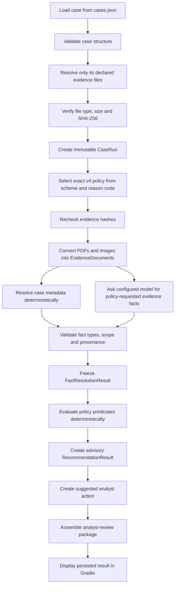
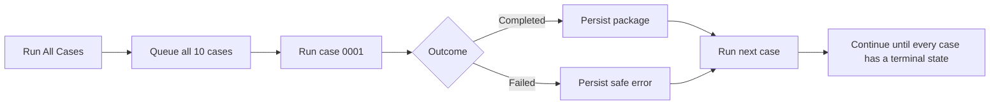

# Dispute Copilot v4: Reproducibility and Operating Guide

This guide explains how to install, verify, run, and inspect the current
Dispute Copilot system. It is written for someone opening the repository for
the first time.

`take-home-v4` is the default rulebook. You do not need to pass a rulebook
flag during normal operation.

## Reproducible checkpoint

The implementation described here is anchored at:

- Preserved v4 baseline commit: `223e9eb`
- Application version: `0.1.0`
- Python: 3.11 or newer
- Default rulebook: `take-home-v4`
- Default working database: `data/v4-live-validation.db`
- Current provider-extension test result: `345 passed, 1 skipped`

The preserved `223e9eb` baseline produced `321 passed, 1 skipped`. The
provider-pluggable extension adds offline adapter and visual-contract tests,
bringing the current result to `345 passed, 1 skipped`.

The skipped test is the deliberately gated live-provider integration test. It
is skipped during ordinary offline testing because it sends evidence to the
configured model provider and may incur cost.

The committed default database contains completed live attempts for:

- `CB-2025-0001`
- `CB-2025-0002`
- `CB-2025-0004`
- `CB-2025-0007`

A frozen online-backup copy is stored at:

`data/baselines/take-home-v4-g5-live/v4-live-validation.db`

That frozen copy is for reproducibility and should not be used for new live
runs.

## What the system does

Dispute Copilot receives a supplied dispute case and its declared evidence,
selects the exact applicable policy, extracts only the facts requested by that
policy, evaluates the policy deterministically, and prepares an advisory
package for an analyst.

The model is allowed to propose evidence facts. It is not allowed to decide
whether a policy requirement is met or choose the recommendation.

The analyst interface displays:

- the case and transaction summary;
- the advisory recommendation;
- a short deterministic rationale;
- every policy requirement and its grade;
- admitted facts and their source citations;
- evidence that was inspected but remains insufficient;
- evidence gaps;
- a separate suggested next action;
- source PDF pages or images;
- immutable technical lineage.

The interface never submits a chargeback response or takes another external
dispute action.

## One-case workflow



Important boundaries:

- The case supplies the scheme and reason code. The caller cannot substitute a
  different policy key.
- Evidence filenames come from the immutable case snapshot. The system does
  not discover unrelated files in the evidence directory.
- Extraction processes the exact bytes admitted at intake. Missing or modified
  files are rejected.
- A model response must pass strict local schema, citation, value-type,
  source-scope, and provenance validation.
- Image conversion keeps `written_text_observations`,
  `visible_pixel_observations`, and `limitations` separate. The validated
  structure is rendered deterministically into canonical page text.
- A caption is a written source claim. A pixel observation describes only
  what is visible. Neither may establish hidden condition, full product
  matching, or customer return behaviour.
- Invalid extraction fails closed. It does not produce a partial fact result
  or downstream recommendation.
- `NOT_FOUND` means the fact was not established. It does not prove the
  opposite fact.
- Requirement evaluation and recommendation mapping run locally without a
  model call.

## Moving from one case to another

Each case attempt receives its own immutable lineage:

```text
CB-2025-0001
  └─ CaseRun A
     └─ PolicySelection A
        └─ FactResolution A
           └─ Evaluation A
              └─ Recommendation A
                 └─ AnalystReviewPackage A

CB-2025-0002
  └─ CaseRun B
     └─ PolicySelection B
        └─ FactResolution B
           └─ Evaluation B
              └─ Recommendation B
                 └─ AnalystReviewPackage B
```

Case B never reuses Case A's case snapshot, evidence bundle, extracted facts,
policy snapshot, recommendation, or review package.

When the analyst changes the selected case:

- a completed case loads its persisted package without rerunning the model;
- a failed case displays its recorded safe failure;
- an unprocessed case displays `NOT_RUN`;
- facts, recommendations, citations, evidence and gaps from the previously
  selected case are cleared.

Retrying a case creates a new attempt and a new immutable lineage. It does not
overwrite the previous attempt.

## Run-all workflow



The cases run sequentially. A failure in one case does not terminate the
remaining cases.

The queue uses:

- `NOT_RUN`
- `QUEUED`
- `RUNNING`
- `COMPLETED`
- `FAILED`

Every completed or failed attempt is recorded independently in SQLite.

## 1. Obtain the repository

```bash
git clone <repository-url>
cd dispute-copilot
git checkout <commit-containing-the-provider-extension>
```

Record the exact reviewed commit hash with every test or live-provider result.
Commit `223e9eb` remains the preserved pre-extension v4 checkpoint; checking
out that commit intentionally omits the three-provider extension.

## 2. Create the Python environment

Confirm that Python 3.11 or newer is available:

```bash
python3 --version
```

Create and activate an isolated environment:

```bash
python3 -m venv .venv
source .venv/bin/activate
```

Install the application and development dependencies:

```bash
python -m pip install -e ".[dev]"
```

Confirm the installed command:

```bash
dispute-copilot --version
```

## 3. Configure the live provider

Create a local configuration file:

```bash
cp .env.example .env
```

Populate `.env` with exactly one selected provider and model. The application
registers only `nebius`, `openai`, and `anthropic`.

Nebius:

```dotenv
MODEL_PROVIDER=nebius
MODEL_NAME=Qwen/Qwen2.5-VL-72B-Instruct
MODEL_API_KEY=<your-nebius-api-key>
MODEL_BASE_URL=https://api.tokenfactory.nebius.com/v1/
RUN_MODEL_PROVIDER_INTEGRATION=0
ANALYST_IDENTITY=<your-local-analyst-id>
```

OpenAI:

```dotenv
MODEL_PROVIDER=openai
MODEL_NAME=<your-compatible-openai-model>
MODEL_API_KEY=<your-openai-api-key>
MODEL_BASE_URL=https://api.openai.com/v1/
RUN_MODEL_PROVIDER_INTEGRATION=0
ANALYST_IDENTITY=<your-local-analyst-id>
```

Anthropic:

```dotenv
MODEL_PROVIDER=anthropic
MODEL_NAME=<your-compatible-anthropic-model>
MODEL_API_KEY=<your-anthropic-api-key>
MODEL_BASE_URL=https://api.anthropic.com/
RUN_MODEL_PROVIDER_INTEGRATION=0
ANALYST_IDENTITY=<your-local-analyst-id>
```

`MODEL_BASE_URL` may be omitted to use the selected provider's registered
default endpoint. A supplied value must be a credential-free HTTP(S) URL.

Rules:

- Never commit `.env`.
- Never paste the API key into source code, SQLite, screenshots, test fixtures,
  or command-line arguments.
- The application uses the exact configured provider and model. It does not
  silently substitute another model.
- It performs no automatic provider routing, fallback, or cross-provider
  retry.
- The selected model must support image input and the adapter's exact
  structured-output schema. Incompatibility fails closed.
- `ANALYST_IDENTITY` identifies the person operating the local review server.
  It is resolved from server configuration, not accepted from browser input.

Load the variables into the current shell:

```bash
set -a
source .env
set +a
```

## 4. Verify the offline system

Run the complete ordinary suite:

```bash
python -m pytest -q
```

For the provider-pluggable implementation described by this guide, the
expected result is:

```text
345 passed, 1 skipped
```

This proves the deterministic contracts, v4 case behaviour, persistence,
failure isolation, cached reopening, UI callbacks, and fixture-backed
extraction paths. It does not make a live provider call.

Optionally run the gated provider contract test:

```bash
RUN_MODEL_PROVIDER_INTEGRATION=1 \
python -m pytest -q \
tests/test_lean_fact_resolution.py::test_real_provider_cb_2025_0006_contract
```

This transmits evidence to the configured provider and may incur cost.

### Provider validation status

Offline contract tests prove adapter request shape, canonical result types,
strict validation, secret-safe errors, and identical deterministic treatment.
They do not prove the behaviour of a real configured model.

Provider status must use one of these labels:

- `IMPLEMENTED_AND_CONTRACT_TESTED_NOT_LIVE_VALIDATED`
- `LIVE_VALIDATION_FAILED`
- `LIVE_VALIDATED`

A provider is `LIVE_VALIDATED` only after the real configured model completes
this qualification pack:

- `CB-2025-0004`: persuasive fraud-report language is not treated as
  Mastercard policy proof;
- `CB-2025-0006`: caption text, visible pixels and image limitations remain
  separate, and visible appearance does not establish hidden condition;
- `CB-2025-0007`: the transaction-specific record is found and cited on page
  8, then compared with the frozen shipping address.

A successful connection test alone is not live validation. If credentials are
unavailable, the honest status remains
`IMPLEMENTED_AND_CONTRACT_TESTED_NOT_LIVE_VALIDATED`.

## 5. Inspect the frozen persisted checkpoint

Start the application in cached mode against the immutable backup:

```bash
python -m dispute_copilot.application.demo \
  --mode cached \
  --database \
  data/baselines/take-home-v4-g5-live/v4-live-validation.db
```

Open the local URL printed by Gradio, normally:

`http://127.0.0.1:7860`

Cached mode:

- disables live run controls;
- requires no model-provider call;
- reconstructs packages from SQLite;
- labels the view as persisted/cached;
- lets the analyst switch between completed cases.

Stop the server with `Ctrl+C`.

## 6. Run the live system

The normal v4 launch command is:

```bash
python -m dispute_copilot.application.demo --mode live
```

This uses:

- rulebook: `take-home-v4`;
- database: `data/v4-live-validation.db`;
- server: `127.0.0.1`;
- port: `7860`.

### Run one case

1. Select the case from **Case queue**.
2. Click **Run Selected Case**.
3. Observe `QUEUED`, `RUNNING`, and the terminal state.
4. If it completes, inspect the recommendation, requirements, facts,
   citations, evidence gaps, suggested action and technical lineage.
5. Change cases using the selector. Selecting another completed case loads its
   own persisted result without a model call.

### Run all cases

1. Click **Run All Cases**.
2. Leave the server running while the queue advances sequentially.
3. Inspect every terminal status.
4. Select each completed case to review its persisted package.
5. Select failed cases to inspect their safe failure stage and message.

Do not expect all cases to be forced to `COMPLETED`. A strict extraction or
citation failure is an honest `FAILED` result, and later cases continue.

### Use a clean database

To keep a new experiment separate from the committed live results:

```bash
python -m dispute_copilot.application.demo \
  --mode live \
  --database data/my-v4-validation.db
```

The application creates the SQLite schema and provisions the v4 policy
catalogue automatically. Every run in that database starts a new immutable
attempt.

## 7. Reopen results without a model call

Stop the live server, then use the same database in cached mode:

```bash
python -m dispute_copilot.application.demo \
  --mode cached \
  --database data/my-v4-validation.db
```

The run buttons are disabled. Selecting a completed case reconstructs the
stored analyst-review package and evidence links without creating a provider
runtime.

## 8. Verify stored checkpoints

Verify the committed working live database before modifying it:

```bash
shasum -a 256 -c data/checksums/v4-live-validation.sha256
```

Verify the immutable G5 backup at any time:

```bash
shasum -a 256 -c \
  data/baselines/take-home-v4-g5-live/checksums.sha256
```

Verify the isolated G4 single-case live proof:

```bash
shasum -a 256 -c \
  data/checksums/v4-g4-cb-2025-0004.sha256
```

Running a new case changes the working database by design, so its original
checksum will no longer match. The immutable baseline checksum should continue
to match.

Inspect database integrity:

```bash
sqlite3 -readonly data/v4-live-validation.db \
  "PRAGMA integrity_check; PRAGMA foreign_key_check;"
```

The expected integrity result is `ok`, followed by no foreign-key violations.

Inspect case attempts:

```bash
sqlite3 -readonly -header -column data/v4-live-validation.db \
  "SELECT case_id, attempt_number, status, execution_mode
   FROM demo_case_attempts
   ORDER BY case_id, attempt_number;"
```

## Persistence and integrity behaviour

SQLite stores separate immutable records for:

- case runs;
- policy selections and complete policy snapshots;
- converted evidence documents;
- fact-resolution results;
- requirement evaluations;
- recommendations;
- analyst-review packages;
- suggested analyst actions;
- analyst decisions;
- application attempts and progress events.

New processing never updates the original case or policy snapshot. Later
workflow stages point back to earlier records through IDs and content hashes.
Duplicate immutable IDs and conflicting writes are rejected.

Credentials are read from the process environment and are not stored in the
database. Normal logs and persisted errors use sanitised messages.

## Understanding the analyst output

### Recommendation

The recommendation is the system's advisory output based on the current
admitted record. It is not the analyst's decision.

### Requirement grades

- `SATISFIED`: the policy predicate evaluated true.
- `NOT_SATISFIED`: admitted evidence established a false predicate.
- `NOT_ESTABLISHED`: the available record was insufficient, ambiguous or
  conflicting.

### Supporting evidence

Text facts retain the exact supporting excerpt, source filename, page number,
and extraction method. Visual facts are explicitly labelled as model
observations.

### Evidence gaps

Gaps identify policy-requested facts that were not established. They do not
claim that the opposite event occurred.

### Suggested action

The suggested action is separate from the recommendation. For example, the
system may recommend not representing on the current record while separately
suggesting that the analyst request a named carrier or transaction document.

### Analyst decision

The analyst may confirm, override, request more evidence, or close without
deciding. A submitted decision is persisted immutably. Closing without deciding
writes no decision.

## Current limitations

- Live extraction depends on the configured external provider. Availability,
  latency, cost and model output can vary.
- Deterministic fixture tests are reproducible; exact live-model wording and
  fact outcomes are not guaranteed to be identical between calls.
- Supported intake formats are PDF, PNG and JPEG.
- Native PDF text is the strongest supported text path. Scanned or highly
  visual documents depend more heavily on model-assisted conversion.
- Evidence display usually grounds support to a page or whole image. Precise
  bounding boxes are shown only when real coordinates were persisted; the UI
  never fabricates a highlight.
- Provider latency, token usage and estimated cost are currently displayed as
  `NOT RECORDED`.
- The UI shows the latest attempt for a case rather than a complete interactive
  attempt-history browser.
- Batch execution is sequential and intended for a local analyst demo, not a
  high-concurrency production service.
- Recommendations are advisory. No network or external dispute action is taken
  from the analyst interface.

## Minimal presentation sequence

For a repeatable demonstration:

1. Record `git rev-parse --short HEAD`.
2. Run `python -m pytest -q`.
3. Verify the immutable G5 backup checksum.
4. Launch the backup in cached mode and inspect existing packages.
5. Stop cached mode.
6. Launch live mode with a new database.
7. Run one selected case and show its state transitions.
8. Inspect recommendation, requirements, citations, gaps, suggested action and
   lineage.
9. Stop the application.
10. Reopen the same database in cached mode and show that the completed package
    is available without another model call.

Record the commit, database path, provider, exact model name, test result and
terminal case statuses alongside any demonstration results.
